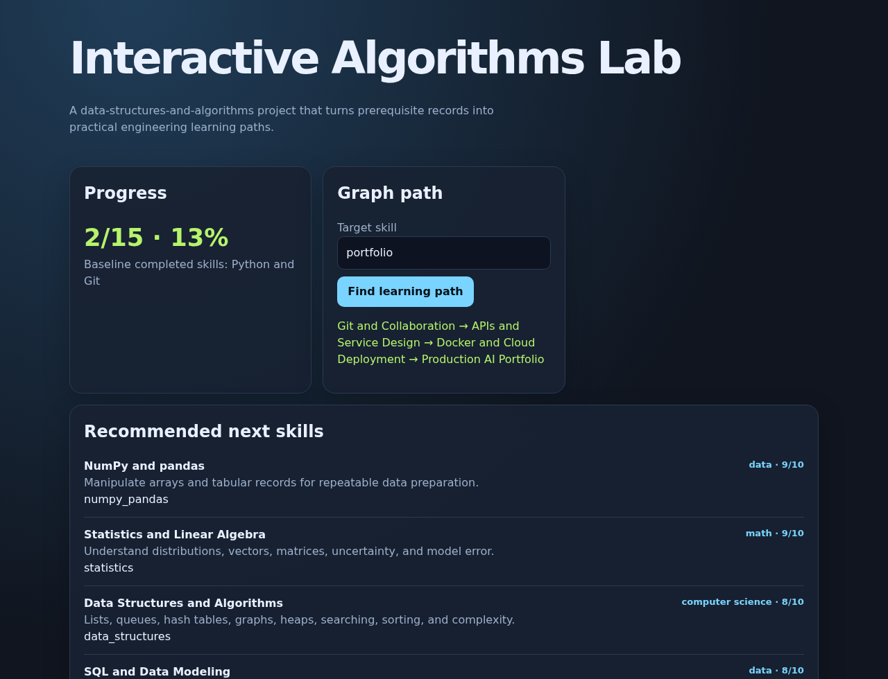

# Interactive Algorithms Lab

I built this Python lab to answer a practical question about a skill roadmap. Given what I already know, what can I learn next? I use the catalog to practice search, traversal, and prerequisite planning. Each chapter pairs its implementation with tests.



I start this example with Python and Git marked complete. For the portfolio target, my planner traces a path through API design and deployment and ranks the skills I can tackle next.

## Chapter 1 Summary: Data Structures and Algorithms

Chapter 1 introduces data structures as organized ways to store and interpret
data, and algorithms as the procedures used to manipulate that data. The key
database-style operations are insertion, search, deletion, and traversal. It
also introduces records, fields, keys, Python sequences, functions,
exceptions, list comprehensions, and object-oriented programming.

This project applies those ideas directly:

- A `Skill` is a record with fields such as `id`, `title`, `category`, and
  `prerequisites`.
- `SkillCatalog` uses a Python dictionary as a hash table keyed by skill ID.
- `SkillGraph` stores prerequisite relationships as an adjacency list.
- `learning_path()` uses breadth-first search with a queue.
- `PriorityQueue` uses a heap to rank eligible skills by importance.
- Search, traversal, sorting, insertion, and lookup are exposed through the
  command-line interface.
- The data structures are implemented as Python classes, demonstrating OOP.

The main Chapter 1 lesson is that data organization and algorithms work
together. A dictionary is useful for direct key lookup, a graph models
relationships between skills, a queue supports breadth-first traversal, and a
priority queue selects the most important eligible skill.

## Run it

From this directory:

```bash
python3 -m ai_engineer_pathfinder
python3 -m ai_engineer_pathfinder.web_app
python3 -m ai_engineer_pathfinder chapter2
python3 -m ai_engineer_pathfinder chapter3
python3 -m ai_engineer_pathfinder chapter4
python3 -m ai_engineer_pathfinder chapter5
python3 -m ai_engineer_pathfinder search deployment
python3 -m ai_engineer_pathfinder next --completed python git numpy_pandas statistics
python3 -m ai_engineer_pathfinder path --completed python git numpy_pandas statistics llm_fundamentals rag
```

The `path` command defaults to the `portfolio` target. Supply a skill ID after
`path` to choose another target, for example:

```bash
python3 -m ai_engineer_pathfinder path pytorch --completed python git numpy_pandas statistics ml_foundations
```

The browser dashboard runs at `http://127.0.0.1:8765` and exposes the same
catalog, graph, and priority recommendations through a small JSON API.
The interactive WebXR lab is available at `http://127.0.0.1:8765/webxr`.
It requires a WebXR-capable browser for immersive mode and includes a normal
desktop fallback for inspecting the simulations without a headset. In desktop
mode, enable walk mode and use WASD or arrow keys with mouse-look; clicking a
station's 3D `RUN` button activates its demonstration, and clicking the floor
teleports the player. In immersive mode, the thumbstick provides locomotion,
controller selection activates stations, and selecting the floor or a `MOVE
HERE` pad teleports the player.

## Chapter 2 Summary: Arrays

Chapter 2 focuses on arrays and the tradeoff between simple storage and fast
search. An unordered array supports constant-time insertion at the end, but a
linear search and deletion may inspect or move many items. An ordered array
keeps values sorted so it can use binary search, reducing search work from
`O(N)` to `O(log N)`, while insertion and deletion still require shifting
items.

The chapter also introduces duplicate-key behavior, records stored by a key
function, logarithms as the basis of binary search, and Big-O notation as a
way to describe how work grows as the data set grows.

The `chapter2` command demonstrates the new array module. `Array` provides
fixed-capacity insertion, linear search, deletion, traversal, indexed access,
numeric maximum operations, and duplicate removal. `OrderedArray` keeps items
sorted and uses a lower-bound binary search. `OrderedRecordArray` stores
objects by a fixed key function, handles duplicate-key deletion, merges two
sorted arrays, and expands its backing storage when full. Each operation keeps
comparison and move counts in `last_stats` so the CLI can show the difference
between `O(N)` linear search and `O(log N)` binary search.

## Chapter 3 Summary: Simple Sorting

Chapter 3 introduces three elementary in-place sorting algorithms. Bubble sort
compares adjacent values and moves the largest remaining value toward the
right. Selection sort scans the unsorted region for its minimum and swaps that
value into the next sorted position. Insertion sort takes one marked value at
a time and inserts it into the already sorted prefix by shifting larger
values.

All three simple sorts are `O(N^2)` for general or worst-case input, but their
operation costs differ. Bubble sort is easiest to understand but usually does
the most swaps. Selection sort still performs `O(N^2)` comparisons but only
`O(N)` swaps, which helps when moving records is expensive. Insertion sort is
often the best choice for small or nearly sorted data and can approach `O(N)`
in that favorable case. The chapter also introduces invariants, stable
sorting, and the odd-even sort extension.

The `chapter3` command compares the algorithms using deterministic input and
reports comparisons, copies, swaps, and the nearly sorted insertion-sort
case. `SortableArray` also includes odd-even sort and an `O(N)` deduplication
pass for an array that has already been sorted.

## Chapter 4 Summary: Stacks and Queues

Chapter 4 introduces abstract structures whose access order is more important
than arbitrary search. A stack is LIFO: `push`, `pop`, and `peek` operate at
one end. A queue is FIFO: `insert` adds at the rear and `remove` takes the
oldest item from the front. `CircularQueue` uses wraparound indices so both
operations remain `O(1)`. `Deque` extends the idea to both ends.

The chapter's priority queue combines ordering with restricted access.
`StablePriorityQueue` keeps lower priority keys at the front of removal order,
preserves FIFO order for equal priorities, performs `O(N)` insertion, and
performs `O(1)` removal and peek. Stacks and queues are also useful as
algorithmic tools: delimiter checking uses a stack, while expression parsing
uses a stack for operators and postfix evaluation.

The `chapter4` command demonstrates LIFO stack behavior, circular FIFO
wraparound, stable priority removal, infix-to-postfix translation, variable
assignment, arithmetic evaluation, and palindrome checking support.

## Chapter 5 Summary: Linked Lists

Chapter 5 replaces array positions with relationships between nodes. A singly
linked list follows `next` references from its first link, so it can grow and
shrink without allocating a fixed block or shifting records. Front insertion
and deletion are `O(1)`; searching for a key or position remains `O(N)`.

The project includes unordered `LinkedList`, `DoubleEndedList`, and
`OrderedList` variants; `DoublyLinkedList` adds previous references for
backward traversal and constant-time deletion at either end; and
`CircularList` maintains one loop with a marked last link. The ADT examples
implement linked stacks, queues, deques, and priority queues without changing
their public access patterns. This demonstrates that an ADT describes what a
structure does while its linked-list or array implementation can change
behind the interface.

The chapter also adds explicit iterators, Python generator-style traversal,
two-level priority queues, and a bidirectional Fibonacci iterator. The
`chapter5` command demonstrates each major list variant and iterator behavior.

### Chapter-by-chapter portfolio convention

Each future chapter will add the following to this README:

1. A plain-language chapter summary.
2. The data structures or algorithms applied in the application.
3. A command that demonstrates the new work.
4. Tests and verified output.

## Test it

```bash
python3 -m unittest discover -s tests -v
```

The project uses only the Python standard library.

See [VERIFICATION.md](VERIFICATION.md) for the current test results,
WebXR evidence boundary, and release limitations.

## Source snapshot

This repository contains the Python package, browser page, generic skill data, tests, product catalog and project documentation. Personal career materials, local deployment units, generated archives and runtime output are excluded. Run from this checkout with Python 3.10 or newer using the commands above. The product catalog is a set of offer templates; no commercial availability or customer outcomes were validated.

Run `python3 -m unittest discover -s tests -v` for the offline suite. Headset WebXR, external feeds, payment providers and production deployment require separate validation. Third-party browser dependencies are described in [THIRD_PARTY_NOTICES.md](THIRD_PARTY_NOTICES.md).

The current product ZIP builder omits `webxr.html`, `LICENSE` and third-party notices; its archive is not a complete release. Use the source checkout until packaging is corrected and verified.
